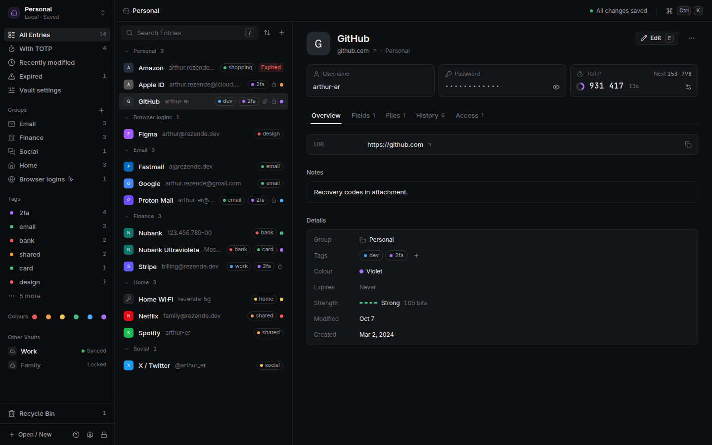
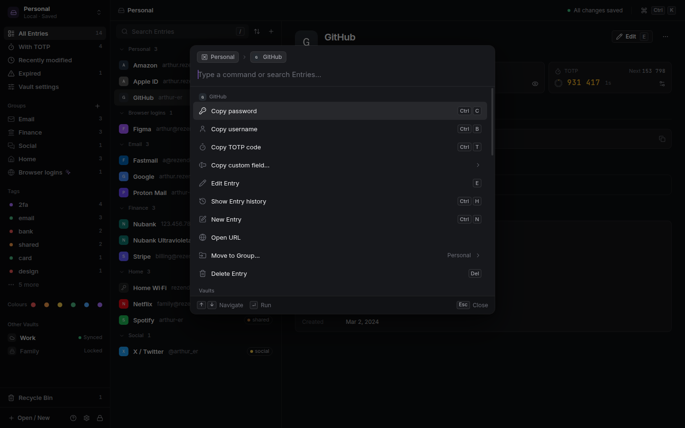
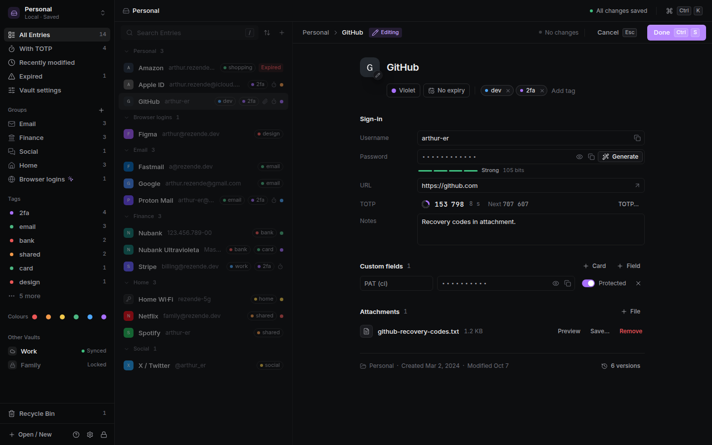
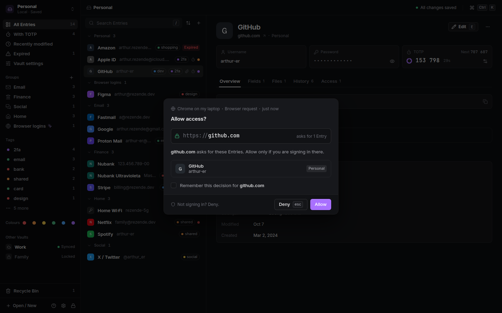

  

<h1 align="center">keefast</h1>

<b>A fast, modern desktop password manager for your KeePass Vaults.</b>

  <a href="docs/install.md">Install</a> ·
  <a href="#features">Features</a> ·
  <a href="docs/browser-integration.md">Browser</a> ·
  <a href="docs/headless-host.md">Agents</a> ·
  <a href="docs/plugins/README.md">Plugins</a> ·
  <a href="CONTRIBUTING.md">Contributing</a>

  
  
  
  

  <picture>
    <source media="(prefers-color-scheme: light)" srcset="docs/media/readme-hero-light.png">
    
  </picture>

keefast opens the KeePass (KDBX) Vault files you already have, and saves them so KeePassXC,
KeePass and KeeWeb still read every bit of them. It is written in Rust, with a Tauri desktop app
that does everything from the keyboard, fills logins and payment cards in the browser, syncs
through Dropbox without overwriting anything, and hands secrets to AI agents only on your terms.

Created in [T3 Code](https://t3.codes).

## Why keefast

- **Your Vault files, untouched.** Nothing to migrate and no account to make. keefast round-trips
  real files written by KeePassXC, KeePass2, KeeWeb and pykeepass, tested against each of them.
- **Fast, from the keyboard.** One command palette (Ctrl+K) for every action and every Entry;
  copy a username, password or TOTP code without reaching for the mouse.
- **Private by default.** No network request you haven't agreed to, favicons kept in memory only,
  updates signed, and a clipboard that clears itself.
- **Ready for agents.** Claude Code, Codex or agentes-chat reach the secrets you put aside for them
  over MCP, with every use approved or logged.

## Install

Download the latest build from [Releases](https://github.com/arthur-er/keefast/releases):

- **Linux:** an AppImage (`chmod +x keefast-*.AppImage` and run it) or a tarball, on Wayland and
  X11.
- **Windows:** an MSI that installs for your user, without administrator rights.
- **Nix:** `nix run github:arthur-er/keefast`, or the flake's package and overlay on NixOS.

[docs/install.md](docs/install.md) covers each in full, browser integration from each, and
updates.

## Features

| Feature | Notes |
| --- | --- |
| KeePass Vaults | Opens KDBX 3.1 and 4 with a master password, a key file or both, saves KDBX 4, and keeps everything other clients wrote (ADR 0002). Several Vaults open at once. |
| Entries | Usernames, passwords, URLs, notes, custom fields (protected or not), attachments, full history, tags, colours, icons and expiry dates, stored as KeePassXC, KeePass and KeeWeb store them. |
| TOTP | Live codes in the Entry, with the next one ahead, copied with Ctrl+T. |
| Password generator | Passwords and passphrases (from the EFF word list), with their strength. |
| Command palette | Ctrl+K lists every action of what has focus, with its keys, and searches Entries. |
| Browser integration | The Companion extension (Chromium MV3) and the stock KeePassXC-Browser extension both pair with keefast, fill logins, and offer to save the ones you submit. See [Browser integration](docs/browser-integration.md). |
| Payment cards | The Card Plugin keeps cards on Entries and fills payment forms, also in a payment provider's frame, only when you pick one. |
| Dropbox | Opens Vault files from Dropbox, Merges what other devices saved instead of overwriting it, and works offline from an encrypted cache. See [Dropbox](docs/dropbox.md). |
| Agents (MCP) | Claude Code, Codex or any MCP client reaches an Agent group's secrets through `keefast-agent`, on this computer ([guide](docs/agents-on-this-computer.md)) or from a Headless host on a server ([guide](docs/headless-host.md)). |
| agentes-chat | A Gateway pairing makes keefast one of agentes-chat's Vault sources, with every value it resolves logged. See [Connecting agentes-chat](docs/agentes-chat.md). |
| Plugins | Third parties teach keefast new kinds of data, in signed WebAssembly packages. See [Writing a keefast Plugin](docs/plugins/README.md). |
| Signed updates | Asks once, then checks GitHub daily; installs only a package signed with keefast's update key, and only when you click Update (ADR 0014). |
| Themes | Dark, Light, or following the system. |

How the app is laid out, its keys and its settings are in [Using keefast](docs/using-keefast.md).

<table>
  <tr>
    <td></td>
    <td></td>
    <td></td>
  </tr>
  <tr>
    <td align="center">Command palette</td>
    <td align="center">Entry editor</td>
    <td align="center">Browser requests</td>
  </tr>
</table>

## Contributing

Bug reports, ideas and pull requests are welcome in
[issues](https://github.com/arthur-er/keefast/issues). [CONTRIBUTING.md](CONTRIBUTING.md) explains
how to build and test it. The stack is Rust (a headless core, with the Workspace and Storage
providers on top) and Tauri 2 with React, TypeScript and Tailwind for the desktop app; the
Companion extension is TypeScript with WXT. Architecture decisions are in [docs/adr](docs/adr).

## License

keefast is licensed under the [MIT License](LICENSE).

Passphrases are made from the [EFF large word list](https://www.eff.org/dice) by the Electronic
Frontier Foundation, licensed under [CC BY 3.0 US](https://creativecommons.org/licenses/by/3.0/us/).
Icons are drawn with [Lucide](https://lucide.dev) (ISC).
